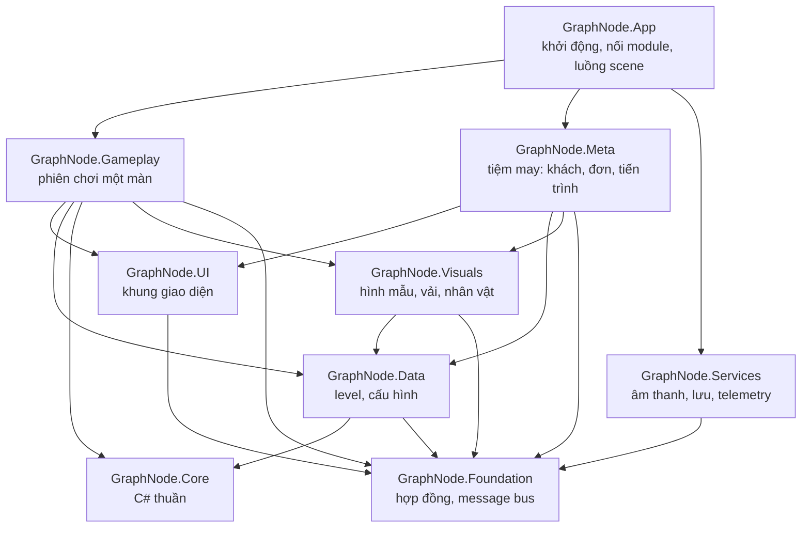
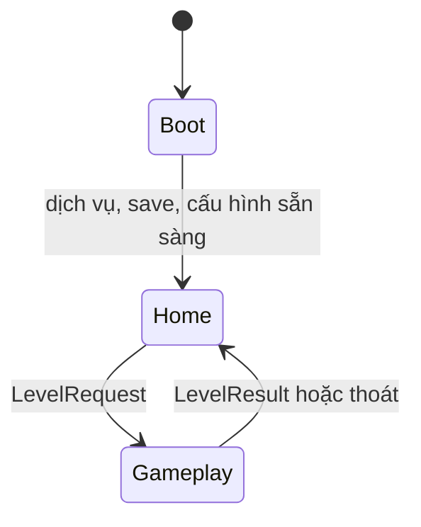
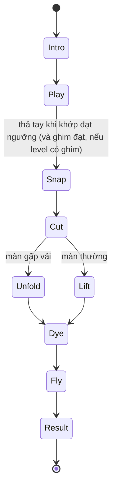

# Kiến trúc kỹ thuật: GraphNode Puzzle

Kế hoạch hệ thống, cấu trúc thư mục và công nghệ cho bản Unity chuẩn production. Luật chơi và số liệu nằm ở đặc tả [GraphNode-Puzzle-Dac-ta.md](GraphNode-Puzzle-Dac-ta.md); tài liệu này chỉ nói **làm bằng gì, đặt ở đâu, nối với nhau thế nào**.

Bản gốc của tài liệu là file này trong repo; đặc tả cũng vậy (bản trên Claude Docs chỉ để đọc và bình luận).

Bản thử web chỉ là demo luật lõi: dùng để đối chiếu luật và số liệu trong test, **không** phải gốc cho hình ảnh, giao diện, cấu trúc code hay meta của bản chính thức. Bản đối chiếu hiện tại là `Prototype/web-demo` (bản web chính từ 2026-11-11, dựng artifact "Cắt Vải Theo Mẫu 2"). `Prototype/web-v2` chỉ đồng bộ khi người dùng yêu cầu; `Prototype/web-v3` không còn cập nhật.

Trạng thái (2026-11-11): xong khung M0 (chưa có CI). Đã có đủ asmdef theo mục 3.1, `Float2` trong Core, hợp đồng `LevelRequest`/`LevelResult`, message bus, interface dịch vụ và `IGameFlow`, dịch vụ rỗng, phạm vi App (`AppScope`) với `Boot`/`Home`/`Gameplay`, chốt chặn build gói MCP. Test: EditMode 9/9, PlayMode 1/1 (luồng Boot → Home → Gameplay → Home). M1 đang làm: đã có `LevelModel`, `RingTopology`, `SolutionBends`, `IEdgeShape`/`HermiteEdgeShape`, `RegionMask` (gồm hợp mặt nạ màn gấp), `MatchScorer` (giao chia hợp, phạt độ uốn); Data đọc file level JSON (`LevelJson`). Chốt: `PinBoard` (ghép cặp gần nhất, chốt của node, đích độ uốn theo chốt), `PinRelabeler` (đánh số lại khi đặt theo phép xoay hay soi gương), `INodeConstraint` với `PinMagnet`, và `BendMagnet`. Test đối chiếu 14 level web-demo cùng 7 cách đặt xoay và soi gương của alt-solve.js: Sinh vị trí đầu: `SeededRandom` (FNV-1a + mulberry32, cùng dãy số với bản web), `TierParams`/`StartGenParams`, `StartPositionGenerator` sinh lại đúng vị trí đầu, độ uốn đầu, cạnh phải tự uốn và vị trí kim đã ghi trong 14 file level. Bộ lọc chạm: `TouchArbiter` (vùng chọn theo mật độ, 3 lớp, kim màn gấp) với các tình huống của đặc tả. Điểm sáng: `IRunnerRule`/`ConstantSpeedRule`, `RunnerSimulator` (gắn cạnh và tỉ lệ, báo mọi node qua, chạy ngược), `CutTiming` (hệ số theo chu vi, khớp bảng số của đặc tả), `Pentatonic` (thang leo qua quãng tám). Kiểm tra level: `LevelValidator` trả `ValidationReport` (lỗi và cảnh báo có mã), 14 level web-demo không lỗi, hai màn gấp mức dễ có cảnh báo lệch khoảng độ khớp đã biết. EditMode 180/180, PlayMode 1/1. Đo trên Editor: dựng mặt nạ và chấm điểm 1,7 ms mỗi khung ở màn nặng nhất (ghi ở đặc tả mục Hiệu năng). M1 còn: đo trên máy Android. M2 đang làm (2026-11-11): `PuzzleState` (Core/Session) giữ vị trí node, độ uốn, kim, độ khớp và chốt, nhận lệnh kéo và thả node, dây, kim theo đúng luật thả tay của bản web (đặt hẳn vào chốt, thả dây vào đích, kim về trục, đánh số lại, xét thắng); `IWinCondition` (ngưỡng, đủ chốt), `IHintProvider` (`FarthestHintProvider`), ràng buộc khung vải và mép gấp, `BendDrag` (hệ số theo điểm bắt). Data: `GameplayBalanceConfig`, `InputConfig` (số pt quy đổi theo cỡ khung vải), `LevelCatalog`; asset mặc định tạo bằng menu GraphNode/Content/Create Missing Default Configs. Test chơi trọn màn qua `PuzzleState` (viên kem, lá xoay một bước, trái tim gấp), kéo và tính lại không cấp phát. EditMode 192/192. Chưa có: input Input System, hiển thị, HUD (chờ người dùng chọn cách vẽ tạm).

**Ý chính:** game chia thành một lõi C# thuần (hình học và luật chơi) và các module Unity theo tính năng. Các module nói chuyện với nhau qua hợp đồng chung (dữ liệu vào ra của một màn, thông điệp, interface dịch vụ). Meta loop sau này là một module mới cắm vào các hợp đồng đó, không phải sửa phần chơi màn.

---

## 1. Nguyên tắc

1. **Lõi thuần, hiển thị mỏng.** Mọi tính toán có thể sai (viền ngoài, điểm khớp, ghim, điểm sáng) nằm trong `GraphNode.Core`, không tham chiếu UnityEngine, chạy được trong test EditMode và tái hiện được theo từng bước thời gian.
2. **Dữ liệu điều khiển.** Level là file JSON gốc có `schemaVersion`; chương, sản phẩm, khách và thông số cân bằng là ScriptableObject. Thêm màn hay chỉnh số không sửa code.
3. **Phụ thuộc một chiều.** Module tính năng không tham chiếu lẫn nhau. Gameplay không biết Meta, Meta không biết bên trong Gameplay. Chỉ `GraphNode.App` biết tất cả để nối lại.
4. **Mở rộng bằng thêm, không bằng sửa.** Cơ chế mới đi qua các điểm mở rộng có sẵn (`IEdgeShape`, `INodeConstraint`, `IWinCondition`, `IPinRule`, `IRunnerRule`, `IHintProvider`, `IPresentationStep`, phần lưu theo mục). Không rải `if (levelType == ...)` trong code chơi.
5. **Bất đồng bộ có vòng đời.** Mọi tác vụ chờ (animation, nạp dữ liệu) dùng UniTask kèm `CancellationToken` gắn với đối tượng hoặc phiên chơi.
6. **Đo được.** Mỗi màn phát ra kết quả và sự kiện telemetry đủ để đo các chỉ số trong đặc tả.

---

## 2. Công nghệ

| Hạng mục | Lựa chọn | Trạng thái | Lý do |
| --- | --- | --- | --- |
| Engine | Unity 2022.3.62f3 LTS | Đã có | Bản LTS, hỗ trợ C# 9 |
| Render | URP 14.0.12, Renderer 2D | Đã có | SRP Batcher, 2D lights nếu cần |
| Input | Input System 1.14.2 | Đã có | Một hành động con trỏ cho cảm ứng và chuột |
| Bất đồng bộ | UniTask (`Assets/Plugins/UniTask`) | Đã có | Không cấp phát, có CancellationToken, thay coroutine |
| Tween | DOTween (bản dll trong `Assets/Plugins/Demigiant`) | Đã có | Trình diễn và UI. Muốn `await` tween bằng UniTask phải bật define `UNITASK_DOTWEEN_SUPPORT` (đổi ProjectSettings, **cần duyệt**) |
| Chữ | TextMeshPro 3.0.7 | Đã có | Font Baloo 2 có đủ ký tự tiếng Việt |
| Test | Test Framework 1.1.33 | Đã có | EditMode cho lõi, PlayMode cho luồng màn |
| JSON | Newtonsoft Json (`com.unity.nuget.newtonsoft-json` 3.2.2) | Đã có | Phụ thuộc trực tiếp của project, không còn dựa vào gói MCP. `JsonUtility` không làm được dictionary và kiểu đa hình mà save và level cần |
| Tiêm phụ thuộc | Nối thủ công qua hàm khởi tạo (pure DI) ở M0 tới M3; xem lại VContainer trước khi làm meta mở rộng | **Đề xuất, cần chốt** | Không thêm gói. Mọi lớp nhận phụ thuộc qua hàm khởi tạo, mỗi scene một lớp nối trong `App`. Khi phần nối dài và khó theo dõi thì chuyển sang VContainer, chỉ sửa phần nối |
| Hình học | Tự viết trong Core | Không thêm gói | Đồ thị nhỏ (tới 14 node); giữ đúng cách tính của bản thử (mặt nạ 200×200) để số liệu đối chiếu khớp. Clipper2 để dành nếu cần phép đa giác chính xác (vùng cấm, khoét lỗ) |
| Nội dung | Level: file JSON là bản gốc. Định nghĩa có asset (khách, sản phẩm, vải, cấu hình): ScriptableObject | Không thêm gói | JSON dễ xem khác biệt trong git, dễ gộp, kiểm tra được trong test thuần C#, sau này tải từ xa được. Level không cần tham chiếu asset trực tiếp, chỉ dùng id |
| Addressables | Không dùng ở bản đầu | Để sau | Thêm khi cần cập nhật level từ xa hoặc khi meta có nhiều art |
| Ngôn ngữ | `ILocalizer` và bảng chuỗi riêng | Để sau mới thay | Có thể đổi sang gói Unity Localization mà không sửa nơi gọi |
| Telemetry, crash, remote config | Interface trong Foundation | Chốt nhà cung cấp sau | Firebase hoặc Unity Gaming Services; code chơi không gọi thẳng SDK |
| CI | GitHub Actions + GameCI | **Đề xuất, cần chốt** | Cần license Unity cho máy CI |
| Gói không dùng | Visual Scripting (`com.unity.visualscripting`) | Đã gỡ | Không dùng, làm chậm biên dịch |
| Gói chỉ dùng khi phát triển | MCP for Unity | Giữ ở Editor | Gỡ khỏi bản phát hành (xem CLAUDE.md mục Build). `manifest.json` đang trỏ vào nhánh `#main`, mỗi lần nạp lại có thể ra bản khác: **đề xuất ghim vào một tag hoặc commit, cần duyệt** |
| Timeline | Đã có | Tùy chọn | Có thể dùng cho cảnh lộ diện sản phẩm |

---

## 3. Kiến trúc tổng thể

### 3.1 Các assembly

| Assembly | Chứa gì | Tham chiếu |
| --- | --- | --- |
| `GraphNode.Core` | Hình học, đồ thị, viền ngoài, điểm khớp, luật thắng, điểm sáng, ghim, kiểm tra level. C# thuần | Không gì cả (`noEngineReferences: true`) |
| `GraphNode.Foundation` | Hợp đồng dùng chung: dữ liệu vào ra của màn, thông điệp, interface dịch vụ, message bus, máy trạng thái, log | UniTask |
| `GraphNode.Data` | ScriptableObject định nghĩa level, chương, sản phẩm, cấu hình cân bằng; DTO JSON; chuyển đổi phiên bản | Core, Foundation |
| `GraphNode.Services` | Cài đặt dịch vụ: âm thanh, nốt nhạc, rung, lưu trữ, telemetry, chuỗi, nạp asset | Foundation, UniTask, Newtonsoft |
| `GraphNode.UI` | Khung giao diện: điều hướng màn hình, popup, toast, nút chung | Foundation, UniTask, DOTween, TMP |
| `GraphNode.Visuals` | Hiển thị dùng chung cho cả màn chơi và tiệm may: `ShapePreview` (vẽ hình mẫu nét đứt), vật liệu vải (`FabricMaterial`), nhân vật nhiều lớp (`CharacterView`) | Data, Foundation, UniTask, DOTween |
| `GraphNode.Gameplay` | Phiên chơi một màn: máy pha, input kéo, hiển thị đồ thị, điểm sáng, trình diễn thắng, HUD trong màn | Core, Data, Foundation, UI, Visuals, UniTask, DOTween, Input System, TMP |
| `GraphNode.Meta` | Tiệm may bản đầu: khách ở quầy, đơn nhiều mảnh, tiến trình. Sau này: khách có câu chuyện, lookbook, vải, nâng cấp tiệm, tiền công. Tách thành nhiều assembly khi lớn (mục 6) | Data, Foundation, UI, Visuals |
| `GraphNode.App` | Điểm khởi động, composition root, luồng scene | Tất cả ở trên |
| `GraphNode.Editor` | Level Editor, trình kiểm tra level, chốt chặn build | Core, Data, Foundation (chỉ Editor) |
| `GraphNode.Tests.EditMode` | Test lõi và dữ liệu | Core, Data, Foundation |
| `GraphNode.Tests.PlayMode` | Test luồng màn từ vào tới bảng kết quả | App, Gameplay, Data |



**Luật phụ thuộc:** không mũi tên nào chỉ vào `App`. Không có mũi tên giữa `Gameplay` và `Meta`. `Core` không chỉ ra đâu cả. Vi phạm luật này là lỗi review.

### 3.2 Gameplay và Meta nói chuyện thế nào

- **Vào màn:** Meta gửi `LevelRequest` gồm `levelId`, `fabricId` (tùy chọn, đè lên vải mặc định của level khi người chơi tự chọn vải), số booster người chơi đang có theo từng loại (bản đầu: booster gợi ý) và danh sách `modifiers` chung. Gameplay chỉ hiểu booster và modifier qua interface, không biết chúng đến từ cửa hàng hay phần thưởng.
- **Ra màn:** Gameplay phát `LevelResult` lên message bus, gồm: `levelId`, `fabricId` thực dùng, kết quả (thắng hay bỏ), số booster đã dùng theo từng loại, số liệu chơi (thời gian, số lần kéo, đặt lại, đảo chiều, lần kiểm tra thất bại). Meta trừ booster và lưu; Gameplay không ghi save. Thoát giữa màn cũng phát `LevelResult` (kết quả "bỏ") nên booster đã dùng vẫn được trừ. Hình mảnh vải không cần gửi kèm: Meta lấy từ `targetShape` của `levelId`. Meta nghe để cho mảnh bay vào thẻ đơn, mở màn tiếp, đặt mảnh vào sản phẩm, tính thưởng. Telemetry nghe để gửi sự kiện.
- **Chuyển cảnh:** cả hai phía gọi `ISceneTransition` (mục 5.11), không tự nạp scene.
- **Lưu:** mỗi module có mục lưu riêng. Thêm module meta là thêm mục lưu, không đụng mục cũ.

---

## 4. Cấu trúc thư mục

Giữ các thư mục đang có (`Plugins`, `Settings`, `Docs`, `Resources`). `SampleScene` sẽ được thay bằng ba scene thật.

```text
Assets/
├── Docs/                         Đặc tả, kiến trúc, wireframe Home dọc
├── Plugins/                      Bên thứ ba (UniTask, DOTween). Không sửa
├── Settings/                     URP, Renderer 2D (đã có)
├── Resources/                    Chỉ cấu hình của plugin (DOTweenSettings). Không thêm asset game
├── Scenes/
│   ├── Boot.unity                Khởi tạo dịch vụ, nạp save và cấu hình
│   ├── Home.unity                Tiệm may: khách ở quầy, bong bóng suy nghĩ, thẻ đơn
│   └── Gameplay.unity            Một scene dùng chung cho mọi level
├── Scripts/
│   ├── Core/                     GraphNode.Core
│   │   ├── Geometry/             Float2, đoạn, đường gấp khúc, giao điểm, cong Hermite
│   │   ├── Graph/                NodeId, loại node, đồ thị, trạng thái vị trí
│   │   ├── Shapes/               IEdgeShape: cạnh uốn theo độ uốn (Hermite pha tiếp tuyến), độ uốn lời giải
│   │   ├── Constraints/          INodeConstraint: khóa, giới hạn khung vải, hút về chốt, hút độ uốn, mép gấp, khoảng kim
│   │   ├── Outline/              Mặt nạ vùng tô, viền ngoài
│   │   ├── Scoring/              Điểm khớp, độ lệch viền
│   │   ├── Rules/                IWinCondition: ngưỡng khớp, đủ chốt, vùng cấm (sau); IHintProvider
│   │   ├── Session/              PuzzleState: trạng thái màn và lệnh kéo, thả; PuzzleConfig
│   │   ├── Runner/               Mô phỏng điểm sáng: chiều dài cung, chiều chạy, hệ số tốc độ khi thắng
│   │   ├── Pins/                 Chốt trên viền mẫu: ghép node với chốt, bộ đếm, đánh số lại theo chốt
│   │   ├── Fold/                 Gấp vải: nửa vòng, gộp mặt nạ hai nửa, vòng viền nhiều lớp (có lỗ), đoạn cắt, khoảng kim
│   │   ├── Generation/           Sinh vị trí ban đầu theo mức độ khó, RNG có hạt giống (dùng bởi Level Editor)
│   │   ├── Input/                TouchArbiter: bộ lọc chạm thuần (node, dây, kim), test EditMode được; Gameplay/Input quy đổi pt và đọc Input System
│   │   └── Levels/               Mô hình level lúc chạy, trình kiểm tra level
│   ├── Foundation/               GraphNode.Foundation
│   │   ├── Contracts/            LevelRequest, LevelResult, các thông điệp
│   │   ├── Services/             IAudioService, IHaptics, ISaveService, IAnalytics, ILocalizer, IAssetProvider, IClock
│   │   ├── Messaging/            Message bus có kiểu
│   │   ├── StateMachines/        Máy trạng thái bất đồng bộ dùng chung
│   │   └── Logging/              Log có thể loại bỏ khi build phát hành
│   ├── Data/                     GraphNode.Data
│   │   ├── Definitions/          LevelDefinition (đọc từ JSON), LevelCatalog, ChapterDefinition, ProductDefinition, PinDefinition, DepthProfile
│   │   ├── Configs/              Cấu hình cân bằng, điểm sáng, input, âm thanh, trình diễn, DifficultyTierConfig
│   │   └── Serialization/        DTO JSON, chuyển đổi phiên bản
│   ├── Services/                 GraphNode.Services
│   │   ├── Audio/                Mixer, SFX, NoteService (pool giọng)
│   │   ├── Haptics/
│   │   ├── Save/                 Ghi nguyên tử, sao lưu, mục lưu
│   │   ├── Analytics/
│   │   ├── Localization/
│   │   └── Assets/
│   ├── UI/                       GraphNode.UI
│   │   ├── Framework/            Điều hướng màn hình, popup, toast
│   │   └── Common/               Nút, thanh, hộp thoại chung
│   ├── Visuals/                  GraphNode.Visuals
│   │   ├── Shapes/               ShapePreview: hình mẫu nét đứt (bong bóng, thẻ hình mẫu, lookbook)
│   │   ├── Fabric/               FabricMaterial: đổ chuyển sắc màu vải và chi tiết theo mặt nạ
│   │   └── Characters/           CharacterView: thân, biểu cảm, trang phục nhiều lớp
│   ├── Gameplay/                 GraphNode.Gameplay
│   │   ├── Session/              LevelSession, máy pha của màn
│   │   ├── Input/                Kéo tương đối, chọn node theo mật độ, bộ lọc chạm node/dây, nâng node khỏi ngón tay
│   │   ├── View/                 Vải, node, sợi chỉ, vùng tô, chốt, gợi ý uốn, điểm sáng, lớp chiều sâu
│   │   ├── Presentation/         Các bước trình diễn thắng
│   │   └── Hud/                  Thanh khớp, Gợi ý, Đặt lại, Đảo chiều, bảng kết quả màn
│   ├── Meta/                     GraphNode.Meta
│   │   ├── Progression/          Mở màn, lưu tiến trình (bản đầu)
│   │   ├── Orders/               Khách, đơn nhiều mảnh, bong bóng suy nghĩ, khách nhận đồ (bản đầu)
│   │   └── (sau này) Stories/  Lookbook/  Fabrics/  ShopUpgrades/  Currency/
│   ├── App/                      GraphNode.App
│   │   ├── Bootstrap/
│   │   ├── Scopes/               Lớp nối của App, Home, Gameplay
│   │   └── Flow/                 Máy trạng thái ứng dụng, nạp scene, lớp phủ chuyển cảnh
│   └── Editor/                   GraphNode.Editor
│       ├── Fonts/                FontAssetTool: tạo TMP Font Asset Baloo 2 (đã có)
│       ├── LevelEditor/          Dựng graph, chọn mức độ khó và node kéo được, sinh vị trí ban đầu theo seed, ghi JSON
│       ├── Validation/           Kiểm tra hàng loạt, dùng chung với CI
│       └── Build/                Script build, chốt chặn gói MCP
├── Tests/
│   ├── EditMode/                 GraphNode.Tests.EditMode
│   └── PlayMode/                 GraphNode.Tests.PlayMode
├── Content/
│   ├── Levels/Chapter01/         File JSON level (bản gốc)
│   ├── Chapters/
│   ├── Products/                 ProductDefinition: khung, vải nền, ô mảnh, điểm gắn decor, phần mặc lên người (mở rộng)
│   ├── Decors/                   DecorDefinition
│   ├── Customers/                CustomerDefinition
│   ├── Orders/                   OrderDefinition
│   ├── Fabrics/                  FabricDefinition
│   └── Configs/                  Asset cấu hình cân bằng
├── Art/
│   ├── Sprites/  Atlases/  Fonts/  Materials/  Shaders/  VFX/  Depth/
│   ├── Characters/               Chân dung khách theo lớp và biểu cảm
│   ├── Products/                 Sprite sản phẩm, bản phác thảo, mặt nạ đổ vải
│   ├── Decors/                   Sprite decor sản phẩm
│   ├── Fabrics/                  Texture hoa văn vải
├── Audio/
│   ├── Music/  Sfx/  Notes/  Mixers/
└── Prefabs/
    ├── Gameplay/
    └── UI/
        ├── Common/               Nút, chip, thanh dùng chung; SafeArea, Canvas gốc
        ├── Home/                 Bố cục Home (đặt sẵn trong scene Home)
        ├── Gameplay/             HUD (đặt sẵn trong scene Gameplay)
        └── Popups/               Màn hình, popup instantiate khi mở (mục 5.13)
```

Quy ước: namespace trùng đường dẫn dưới `Scripts` (ví dụ `GraphNode.Core.Runner`). Mỗi thư mục cấp hai trong `Scripts` có đúng một asmdef. Asset game không đặt trong `Resources`.

---

## 5. Các hệ thống

### 5.1 Luồng ứng dụng



- `Boot` đặt `Application.targetFrameRate = 60` (khóa cứng 60 fps; mặc định Unity trên mobile là 30), dựng phạm vi App (dịch vụ sống suốt phiên) rồi chuyển sang `Home`. Phạm vi App không bị hủy khi đổi scene.
- `Home` là tiệm may: khách ở quầy, bong bóng suy nghĩ chứa hình mẫu màn kế tiếp, thẻ đơn. Các lớp meta mở rộng sau này cũng sống trong scene này.
- Mỗi màn xong đều quay về `Home` để mảnh vải bay vào thẻ đơn; khách kế tiếp hoặc mảnh kế tiếp bắt đầu từ Home.
- `Gameplay` dựng phạm vi riêng cho một màn; thoát màn là hủy toàn bộ phạm vi, mọi tác vụ bất đồng bộ bị hủy theo token.

### 5.2 Phiên chơi một màn



- **Máy pha** (`LevelPhaseMachine`): mỗi pha là một lớp có `Enter`, `Tick`, `Exit`. Chuyển pha chỉ qua máy. Các pha trình diễn (Snap tới Fly) là danh sách `IPresentationStep` chạy tuần tự bằng UniTask, chạm để tua nhanh, thời lượng lấy từ cấu hình.
- **Thứ tự mỗi khung hình trong pha Chơi:**
  1. Input cập nhật vị trí node đang kéo (qua ràng buộc).
  2. Nếu đồ thị đổi: Core tính lại mặt nạ, điểm khớp, trạng thái vùng cấm.
  3. Core bước điểm sáng theo `dt` (tốc độ, chiều chạy).
  4. Chỉ ở khung hình có sự kiện thả tay: Core xét luật thắng trên vị trí node cuối cùng. Đang kéo thì không xét.
  5. Hiển thị đọc trạng thái và vẽ.
- **Kết quả:** khi vào pha Kết quả, phiên phát `LevelResult` lên message bus rồi mới mở bảng thắng.

### 5.3 Lõi `GraphNode.Core`

| Thành phần | Trách nhiệm | Đối chiếu với bản thử |
| --- | --- | --- |
| `EdgeShapes` | Sinh đường gấp khúc của cạnh vòng theo độ uốn `h` (bản web 2): Hermite bậc ba, tiếp tuyến hai đầu pha giữa hướng dây và tiếp tuyến Catmull-Rom theo `h`, cộng phần lệch pháp tuyến để chỗ phồng bằng `h`. Cạnh trong vẫn theo luật tiếp tuyến cũ. Gợn sóng lúc kéo dây là việc của View, không đưa vào đây để không làm rung điểm khớp | Hàm `edgePoly` |
| `SolutionBends` | Tính một lần lúc vào màn: độ uốn lời giải từng cạnh (`0,125 × (T(a) − T(b)) · n`), cờ cạnh cong, danh sách cạnh uốn | `prepare` (`solBend`, `wasCurved`) |
| `RegionMask` | Vẽ cạnh lên lưới 200×200, tô loang từ biên, ra mặt nạ vùng tô; tham số theo bảng Tham số mặt nạ trong đặc tả | Hàm `region` |
| `MatchScorer` | Giao chia hợp giữa mặt nạ người chơi và mặt nạ dựng từ đồ thị ở vị trí lời giải, trừ phạt độ uốn (`BendPenalty`, đã chốt tính vào thanh khớp); sau này thêm độ lệch viền | Hàm `iou`, `bendPenalty` |
| `PinBoard` | Chốt tại vị trí lời giải: ghép node với chốt (cặp gần nhất trước, mỗi chốt một node, bán kính "đã cắm" chung), số chốt đã lấp, chốt đã có node | Hàm `checkPins` |
| `PinRelabeler` | Khi mọi chốt đã lấp theo một vòng xoay hay soi gương của vòng lời giải: trả về hoán vị node và bảng cạnh mới (cạnh cũ, dấu). Gameplay áp hoán vị lên mọi mảng theo node và theo cạnh. Hàm thuần, test được độc lập | Hàm `canonicalizePins` |
| `SolutionOutline` | Viền lời giải dựng một lần lúc vào màn (24 đoạn mỗi cạnh): sinh `targetShape` (đã gồm độ uốn lời giải và `solBendOverride`), vị trí chốt, đường cho cảnh cắt | Hàm `ringPolyline`, `buildGeo` |
| `RunnerSimulator` | Điểm sáng gắn với cạnh và vị trí tỉ lệ trên cạnh; tốc độ đều khi qua node; cảnh cắt khi thắng chạy theo hệ số tốc độ tính từ chu vi; hai chiều | `runnerStep` |
| `PinChecker` | (Để dành, bản đầu không làm: cơ chế chính là chốt, xem `PinBoard`.) Chỉ khi level có ghim giữa cạnh: lúc thả tay kiểm tra tức thì từng ghim bằng `IPinRule` (khoảng cách tới viền ngoài, thứ tự dọc viền). Thay cho vòng kiểm tra bằng điểm sáng đã bỏ | Ghim tròn, ghim số |
| `IPinRule` | (Để dành cùng `PinChecker`.) Luật của một loại ghim giữa cạnh: "đi qua là sáng", "theo thứ tự"; thêm loại mới (theo nhịp…) bằng một lớp mới | Ghim tròn, ghim số |
| `IRunnerRule` | Quyết định tốc độ và chiều của điểm sáng; thêm hai điểm sáng hay nhảy cổng bằng lớp mới | Tốc độ, đảo chiều |
| `IHintProvider` | Chọn node cần gợi ý (mặc định node xa lời giải nhất, hoặc theo `hintOrder`). Không giữ số booster: số đó đi vào qua `LevelRequest` | Nút Gợi ý |
| `WinConditions` | Chuỗi điều kiện xét lúc thả tay: ngưỡng khớp (đã trừ phạt độ uốn), đủ chốt (`AllPinsFilled`), vùng cấm (sau) | Luật thắng |
| `PinMagnet` | `INodeConstraint` hút node đang kéo về chốt trống gần nhất trong bán kính hút; node mép gấp chỉ hút về chốt mép gấp, node thường không hút về chốt sau kim. Thả trong vùng hút thì đặt hẳn vào chốt. Thay `OutlineMagnet` (giữ lớp cũ làm lựa chọn trong cấu hình) | `applyNodeDrag` |
| `BendMagnet` | Ràng buộc độ uốn khi kéo dây: hút về đích độ uốn trong bán kính. Đích lấy từ `PinBoard` theo chốt hai đầu dây đang nằm (độ uốn của cạnh lời giải giữa hai chốt, đổi dấu nếu ngược chiều); chưa có đích thì không hút. Gợi ý uốn dùng cùng đích; bật về 0 khi gần thẳng, kẹp ±0,18; hệ số đổi từ quãng kéo sang độ uốn theo vị trí điểm bắt trên dây | `applyEdgeDrag` |
| `OutlineMagnet` | (Lịch sử, bản web 1) `INodeConstraint` hút nhẹ node đang kéo về điểm gần nhất trên viền mẫu (node mép gấp chỉ hút dọc kim); thả tay trong vùng hút thì đặt hẳn lên viền | `nearestOnLoop`, `foldCross` |
| `FoldGeometry` | Màn gấp: mặt nạ = nửa vòng hợp bản soi gương qua trục; vòng viền mở ra (viền ngoài và lỗ), đoạn cắt bỏ qua nếp gấp; khoảng kim đi được | `buildFold`, `unionRegion`, `needleRange` |
| `StartPositionGenerator` | Khóa hạt giống mặc định là chuỗi `id:mức` như bản web (để sinh lại đúng file đã có); trường `startSeed` (số) của file level để dành cho khi người thiết kế muốn sinh lại khác. Sinh vị trí ban đầu và độ uốn ban đầu theo mức độ khó từ seed, tất định, đọc tham số từ `DifficultyTierConfig` cộng phần ghi đè của level. Chọn cạnh uốn khi level bỏ trống; so khoảng độ khớp sau khi trừ phạt độ uốn; giữ node kéo được ngoài vùng hút của chốt | `startgen.js` |
| `LevelValidator` | Kiểm tra level cho Editor, CI và test, gồm: cắm đủ chốt mà chưa uốn thì dưới ngưỡng; mọi cách đặt xoay hoặc soi gương thắng được; quy chuẩn khoảng cách (chỉ cảnh báo) | Mục "Kiểm tra hàng loạt" của đặc tả, `check.js`, `alt-solve.js` |

Yêu cầu: API không cấp phát khi đang chơi (bộ đệm dựng một lần lúc vào màn); mọi hàm nhận `dt` và trạng thái, không đọc thời gian hệ thống, để test và phát lại được.

### 5.4 Input

- Một `PointerInput` đọc Input System, chỉ nhận một ngón, hủy kéo khi mất focus.
- `NodePicker` chọn node theo vòng chọn theo mật độ (một nửa khoảng cách tới node gần nhất, kẹp 8,8% tới 22% bề rộng vải theo bản web 2).
- `TouchArbiter`: hàm thuần nhận điểm chạm, vị trí node, đường các cạnh và vị trí kim; trả về Node, Edge (kèm vị trí trên dây), Needle hay không gì. Làm đúng bộ lọc 3 lớp của đặc tả (đoạn giữa dây 25–75%, ưu tiên node trong 25 pt, vùng không bắt dây 31 pt quanh đầu dây, ghim khóa cho bắt dây). Các bán kính đo bằng pt, quy đổi bằng `FabricSpace` theo DPI và scale của canvas. Có test EditMode cho ba tình huống trong đặc tả.
- `RelativeDragController` di chuyển node đúng quãng ngón tay trượt, áp `INodeConstraint` (gồm hút về chốt). Với cảm ứng (`Touchscreen`, không áp cho `Mouse`), cộng thêm độ nâng 22 pt tăng dần theo 14 pt trượt đầu; vị trí logic là vị trí node nhìn thấy.
- `EdgeDragController` đổi độ uốn của cạnh theo quãng kéo vuông góc với dây, áp `BendMagnet`.
- Màn gấp: `NeedleController` nhận kéo trên thanh gạt dài dưới khung vải (hoặc trên cây kim), dời kim theo chiều vuông góc với kim trong khoảng đi được, có hút nhẹ về trục.
- `FabricSpace` quy đổi giữa toạ độ màn hình, toạ độ khung vải (0 tới 1) và đơn vị theo bề rộng vải (bảng Đơn vị đo trong đặc tả). Level chiều sâu kiểu camera nghiêng cũng chỉ thay `FabricSpace`.

### 5.5 Hiển thị

- **Vùng tô và viền:** mặt nạ 200×200 của Core chỉ dùng để chấm điểm. Để vẽ, tách đường viền từ mặt nạ (marching squares), làm mượt rồi dựng mesh vùng tô và nét viền đứt đổi màu, để hình nét trên màn hình độ phân giải cao (mặt nạ vẽ thẳng lên máy 3x là khoảng 5 pixel mỗi ô, dễ mờ hoặc răng cưa). Cả hai cách đều đúng khi cạnh cắt chéo vì cùng đi ra từ một mặt nạ. Ở M2 thử cả cách vẽ thẳng từ texture mặt nạ và cách vẽ từ đường viền, chọn một theo chất lượng hình và chi phí.
- **Cạnh, node, ghim, điểm sáng:** mesh và sprite, cập nhật trên cùng đối tượng.
- **Sợi chỉ (bản web 2):** một mesh dải (triangle strip) động cho cả vòng, đầu tròn, màu ombre bằng vertex color hoặc UV vào texture gradient 5 màu; vùng tô xem trước và đầu kéo đọc cùng một mảng điểm với sợi chỉ. Rung theo đầu kéo và nằm yên khi khớp viền tính trong View từ đường của Core cộng trạng thái đầu kéo, không đổi dữ liệu Core.
- **Quầng sáng, tia khớp dây, gợi ý uốn:** dải mesh mềm dùng texture cạnh mờ (alpha blend hoặc additive), không dùng bloom hậu kỳ để giữ 60 fps trên máy yếu. `CurveHintView` gồm vùng khuyết (đa giác giữa dây và viền mẫu), nút cúc (sprite), sóng vòng cung (mesh nét đứt).
- **Không phóng khung vải khi kéo:** ống kính thở 1,04 lần của bản web 2 đã bỏ (2026-11-09, người chơi thử thấy chóng mặt). Khung vải và camera đứng yên.
- **Chốt:** sprite, có trạng thái trống, đã lấp, sóng gợi ý.
- **Cảnh cắt và miếng vải:** dùng đường viền lời giải (đã biết từ dữ liệu), tam giác hóa một lần lúc vào màn.
- **Chiều sâu:** `DepthLayersView` đọc `DepthProfile`, chỉ là lớp hiển thị, không ảnh hưởng Core.

### 5.6 Âm thanh và rung

- `NoteService` giữ pool AudioSource, giới hạn số giọng, nhận cao độ theo vị trí node và độ lệch tông theo độ khớp (tham số từ cấu hình).
- **Âm thanh bản web 2 trong Unity:** bản web tổng hợp âm bằng WebAudio (Karplus-Strong, quét lọc, nhiễu); Unity dùng clip thu sẵn. Mỗi bậc ngũ cung một clip cho từng âm sắc (chốt gỗ, kalimba, gảy dây) thay vì đổi `pitch` một clip, để giữ âm sắc. Nhịp trễ 50 ms (khớp dây sau tiếng cắm chốt) dùng `AudioSource.PlayScheduled` theo `AudioSettings.dspTime`. Tiếng vải khi kéo là clip lặp, âm lượng theo tốc độ ngón tay. Nén đầu ra bằng hiệu ứng Compressor trong AudioMixer (số của đặc tả làm điểm xuất phát).
- `IHaptics` có bản iOS và Android, tắt được; nhận chuỗi rung (ví dụ 8, 14, 10 ms) chứ không chỉ một xung. Android dùng mẫu rung của `Vibrator`; iOS cần lớp gọi `UIImpactFeedbackGenerator` (plugin native, hỏi trước khi thêm).

### 5.7 Dữ liệu và nội dung

- **Level là file JSON (bản gốc)**, mỗi level một file trong `Content/Levels/`. Trường theo bảng "Dữ liệu một level" trong đặc tả: hình mẫu, node, `ring`, `innerEdges`, `markers`, mức độ khó, `startSeed`, `startGenOverride`, `bendFree`, `startBend`, `keepStart`, `fold` (màn gấp, có `axis`), ngưỡng, độ lệch tối đa (tùy chọn), vải, sản phẩm, thứ tự gợi ý (tùy chọn), `depthProfile`, `forbiddenZones` (sau), tags. Lúc chạy, JSON được đọc thành `LevelDefinition` (lớp C# thường, không phải ScriptableObject).
- Level Editor đọc và ghi thẳng JSON. Không có bản ScriptableObject song song, nên không có hai nguồn lệch nhau.
- **Đưa JSON vào bản build mà không dùng `Resources`:** `LevelCatalog` (một ScriptableObject) giữ danh sách id kèm tham chiếu `TextAsset` tới từng file, do công cụ trong Editor sinh lại tự động. Lớp nối của App giữ tham chiếu tới catalog (gán trong scene Boot), nên Unity đưa các file vào build theo chuỗi tham chiếu. Các ScriptableObject cấu hình cũng đi theo cách này.
- **IL2CPP:** thêm `link.xml` giữ các kiểu DTO và bộ chuyển đổi JSON, để bước cắt code không xóa hàm khởi tạo mà Newtonsoft gọi qua reflection.
- JSON có `schemaVersion`; khi đổi cấu trúc thì viết bước chuyển đổi, không sửa tay file cũ.
- Dữ liệu nhiều loại (loại ghim, điều kiện thắng, hình dạng cạnh) ghi trường `kind` và đọc bằng bộ chuyển đổi tự viết. Không dùng chế độ tự ghi tên kiểu của Newtonsoft (`TypeNameHandling`): kém an toàn và dễ hỏng khi IL2CPP cắt code.
- Level trỏ tới vải, sản phẩm bằng id; định nghĩa có asset (khách, sản phẩm, vải, cấu hình cân bằng) vẫn là ScriptableObject.
- `LevelValidator` (trong Core) dùng chung cho Editor, CI và test.
- Dữ liệu tiệm may (trong Data, dùng bởi Meta và Visuals): `CustomerDefinition` (tên, các lớp chân dung, biểu cảm), `OrderDefinition` (khách, sản phẩm, danh sách level theo thứ tự mảnh, decor theo điểm gắn, màu hoàn thiện), `ProductDefinition` (khung, vải nền tùy chọn, ô mảnh, điểm gắn decor, bản phác thảo, phần mặc lên người cho mở rộng mặc thử), `DecorDefinition`, `FabricDefinition` (texture hoa văn, màu, điều kiện mở khóa).
- `targetShape` của level là nguồn duy nhất cho hình mẫu ở mọi nơi: bóng mờ trong màn, bong bóng suy nghĩ, thẻ đơn, lookbook. Level Editor ghi nó ra từ lời giải.

### 5.8 Lưu trữ

- `ISaveService` lưu theo mục: mỗi mục có khóa và phiên bản riêng (ví dụ `progression`, `settings`, `boosters` khi có booster gợi ý, sau này `economy`, `tailor_shop`).
- Ghi nguyên tử (file tạm rồi đổi tên), giữ một bản sao lưu, đọc lỗi thì quay về bản sao lưu.
- Gameplay không ghi save trực tiếp. Nó phát `LevelResult`, Meta quyết định lưu gì.

### 5.9 Telemetry và log

- `IAnalytics` nhận sự kiện có kiểu (`level_start`, `level_complete`, `pin_fill`, `edge_snap`, `touch_cancel`, `verify_fail`, `level_abandon`). Một bộ chuyển tiếp nghe message bus, code chơi không gọi thẳng SDK.
- Log qua một lớp có `[Conditional]`, bản phát hành chỉ giữ cảnh báo và lỗi.

### 5.10 Cấu hình cân bằng

- Mọi số trong đặc tả (ngưỡng 92%, tốc độ điểm sáng 68% bề rộng vải mỗi giây, cảnh cắt khi thắng nhắm 1,5 s, hệ số tốc độ theo chu vi kẹp 1,6–2,5 lần; snap khi thắng 0,4 bề rộng vải mỗi giây, 0,2–0,5 s; hút nhẹ về viền bán kính 3,5%, lực 0,5, trượt vào viền 0,12 s; kim gấp: hút trục 2,5%, lực 0,6, lật bung 0,9 s, dừng 0,3 s; dung sai ghim 4,3% nếu dùng ghim; vùng chọn 7,1% tới 19%; màu và độ đậm vùng tô; thời lượng trình diễn) nằm trong asset cấu hình, theo đơn vị bề rộng vải.
- Số của bản web 2 (số tạm, cùng asset cấu hình): ngưỡng theo mức 94, 95, 96%; chốt: bán kính hút 4,8%, lực 0,5, bán kính "đã cắm" 4,6%, chờ gợi ý chốt 2,8 s; uốn cạnh: hệ số phạt 0,18, hút độ uốn 3,5%, bật về thẳng 1,8%, kẹp ±0,18, đoạn bắt dây 25–75%; chạm: vùng chọn 8,8–22%, ưu tiên node 25 pt, vùng không bắt dây 31 pt, nâng node 22 pt theo 14 pt trượt; snap tối thiểu 0,48 s, chớp sáng 80 + 400 ms, nhấc 0,45 s, đổ màu 1,15 s, ghép 0,65 s, tua tối đa 1,5 lần; khâu khoảng 15 mũi, mỗi mũi 13–21 pt, rút chỉ 0,76 s. Các số đo bằng pt nằm trong cấu hình input, các số theo bề rộng vải nằm trong cấu hình cân bằng.
- Tham số sinh vị trí ban đầu theo mức độ khó nằm trong `DifficultyTierConfig` (Data/Configs), chỉ Level Editor và trình kiểm tra dùng; game lúc chạy không cần. Bản web 2 thêm: số cạnh uốn tối đa theo mức, ngưỡng mặc định theo mức, khoảng cách tối thiểu 12% và cách chốt 6% lúc đầu màn.
- Sau này có thể ghi đè từ remote config qua interface, không đổi nơi đọc.

### 5.11 Chuyển cảnh giữa Home và màn chơi

**Hiệu ứng bay (bong bóng vào màn, mảnh vải về thẻ đơn) là tùy chọn, không bắt buộc ở bản đầu.** Thứ bắt buộc chỉ là mọi lần đổi scene đều đi qua `ISceneTransition`; bản cài đầu tiên có thể chỉ là mờ dần (fade). Nhờ vậy sau này muốn thêm hiệu ứng bay thì chỉ thay phần cài, không sửa Home hay Gameplay.


- **Vấn đề:** bong bóng suy nghĩ phóng to thành bóng mờ trên tấm vải, và mảnh vải vừa cắt bay về thẻ đơn. Home và Gameplay là hai scene, nên phải có thứ sống qua lúc đổi scene.
- **Cách làm khi có hiệu ứng bay:** `ISceneTransition` trong Foundation, cài trong `App` bằng một canvas phủ thuộc phạm vi App (không bị hủy khi đổi scene).
  - Vào màn: Home đưa cho dịch vụ vị trí màn hình và hình của bong bóng; lớp phủ vẽ hình đó bằng `ShapePreview`, nạp Gameplay, rồi phóng hình tới đúng vị trí bóng mờ trên vải mà Gameplay báo lại; xong thì tắt lớp phủ.
  - Ra màn: Gameplay đưa hình và vải của mảnh vừa cắt; lớp phủ giữ mảnh trong lúc nạp Home, rồi cho bay tới thẻ đơn mà Home báo lại.
- **Luật:** Home và Gameplay không biết nhau; chỉ biết dịch vụ chuyển cảnh và dữ liệu hình. Mọi bước có `CancellationToken`, bấm nhanh hay thoát giữa chừng không để lớp phủ treo.
- **Token của lần đổi scene (M0, có test PlayMode):** lần đổi scene chạy theo token của phạm vi App (`AppScope.LifetimeToken`), không theo token hủy của scene đang gọi, vì chính lần đổi scene hủy scene đó; dùng token của scene sẽ tự hủy tác vụ giữa chừng dù scene mới đã nạp xong. `SceneTransition` từ chối lần đổi thứ hai khi lần trước chưa xong.
- **Phạm vi App:** `AppScope.EnsureCreated()` là nơi duy nhất khởi tạo dịch vụ và đặt `targetFrameRate = 60`. Boot gọi đầu tiên; Home và Gameplay cũng gọi để bấm Play thẳng từ scene đó trong Editor vẫn chạy. Chỉ lớp nối trong App đọc `AppScope.Current`; module tính năng nhận dịch vụ qua tham số.

### 5.12 Hiển thị dùng chung (`GraphNode.Visuals`)

- **`ShapePreview`:** vẽ `targetShape` thành nét đứt có tô nhạt, kích thước tùy chỗ dùng. Có kích thước tối thiểu và độ dày nét theo số node, để hình nhiều node vẫn đọc được trong bong bóng.
- **`FabricMaterial`:** (đổi 2026-11-11 theo phong cách tranh tô màu đã chốt) một shader đổ chuyển sắc tròn ba tông của `FabricDefinition` (sáng ở trên trái, màu nền, tối ở dưới phải) theo mặt nạ, không texture vân nỉ hay len đan. Chi tiết vật thật (ô bánh quế, gân len cổ áo) là một lớp texture xám lặp tùy chọn, nhân với tông màu; UV của chi tiết tính theo toạ độ khung vải (bề rộng vải) chứ không theo cỡ mảnh. Viền mực đen dày đều và sáng viền theo hình vẽ cùng mesh viền mảnh (texture khoảng cách tới mép hoặc dải mesh). Thêm vải hay đổi màu không cần vẽ texture mới. Dùng cho cảnh đổ màu trong màn, mảnh và vải nền khi hoàn thiện sản phẩm, sản phẩm trên người khách, lookbook.
- **`CharacterView`:** nhân vật gồm các lớp (thân, tóc, biểu cảm, trang phục). Trang phục lấy từ phần mặc lên người của `ProductDefinition`, đổ vải bằng `FabricMaterial`. Dùng cho khách ở quầy, cảnh khách nhận đồ; sau này cho mặc thử và lookbook.
- **Quy trình art cho mỗi sản phẩm:** bản phác thảo cho thẻ đơn; khi làm mở rộng mặc thử thì thêm một sprite trang phục, một mặt nạ vùng đổ vải, vị trí đặt hình đắp; cùng kích thước khung với chân dung khách để chồng lớp đúng.

### 5.13 Giao diện (uGUI)

Giao diện (bố cục, art, prefab) do người dùng làm; code chỉ làm View script và Presenter. Dùng uGUI (Canvas) với TextMeshPro, không dùng UI Toolkit.

**Đặt sẵn hay instantiate, chia theo vòng đời:**

| Loại | Ví dụ | Cách làm |
| --- | --- | --- |
| Bố cục chính sống suốt scene | Home: quầy, khách, bong bóng, nút bắt đầu, chip số màn. Gameplay: HUD (thanh khớp, Gợi ý, Đặt lại, Đảo chiều) | Prefab đặt sẵn trong scene |
| Màn hình, popup lúc có lúc không | Cài đặt, bảng thắng, hỏi dùng booster, hết booster | Prefab, `ScreenNavigator` instantiate lần đầu mở rồi giữ lại để ẩn hiện |
| Phần tử lặp theo dữ liệu | Ô tiến độ trên thẻ đơn, toast, decor | Prefab một phần tử, instantiate theo dữ liệu; thứ xuất hiện thường xuyên (toast) dùng pool |

Vải, node, cạnh, ghim, điểm sáng **không phải UI**: là sprite và mesh trong không gian thế giới (`Gameplay/View`, `Visuals`), không đặt trên Canvas.

**View và Presenter (MVP):**

- **View:** `MonoBehaviour` trên prefab, chỉ giữ `[SerializeField]` tới phần tử (`TMP_Text`, `Button`, `Image`), có hàm hiển thị (`Show(...)`, `SetMatch(float)`) và phát sự kiện (`StartClicked`). Không biết save, booster, level. View script và các ô tham chiếu là hợp đồng giữa prefab của người dùng và code.
- **Presenter:** lớp C# thường trong `Meta` hoặc `Gameplay`, nhận dữ liệu và dịch vụ qua hàm khởi tạo, ra lệnh cho View và nghe sự kiện của View. Test được không cần scene.
- Không `GameObject.Find`, không singleton, không `Resources.Load`. Prefab được tham chiếu `[SerializeField]` ở lớp nối của scene trong `App/Scopes`, truyền vào `ScreenNavigator` (`UI/Framework`).
- `ScreenNavigator` giữ ngăn xếp popup, mở đóng bằng UniTask kèm token; tween có `SetLink`. Giao diện sống qua lúc đổi scene (lớp phủ chuyển cảnh, toast) thuộc phạm vi App.

**Thiết lập Canvas (đã chốt):**

| Thông số | Giá trị | Lý do |
| --- | --- | --- |
| UI Scale Mode | Scale With Screen Size | Giao diện co giãn theo màn hình |
| Reference Resolution | 1170 × 2532 | Wireframe 390 × 844 pt nhân 3: 1 pt = 3 px, vùng chạm 44 pt = 132 px; art xuất @3x, Set Native Size là đúng cỡ |
| Screen Match Mode | Expand | Khung 390 × 844 luôn nằm trọn trong màn hình; màn thừa chiều nào thì có vùng trống chiều đó (máy tính bảng thừa hai bên, máy 9:21 thừa trên dưới) |
| Reference Pixels Per Unit | 100 | Mặc định; sprite UI để PPU 100 |

- **Tách Canvas theo tần suất đổi:** phần tử đổi liên tục (thanh khớp khi kéo) nằm trên Canvas con riêng, để không dựng lại mesh của cả HUD.
- **Neo theo % như wireframe:** các vùng của Home dùng anchor min/max theo trục dọc đúng tỉ lệ ở bảng vị trí trong đặc tả; phần tử cỡ cố định neo vào vùng chứa nó.
- **Safe area:** một component trên root co vùng nội dung tránh tai thỏ. Nội dung quan trọng nằm trong khung 390 × 844 và trong safe area.
- **Ảnh nền vẽ tràn:** tường, sàn, trần rộng tới khoảng tỉ lệ 3:4 và cao tới khoảng 9:21, để vùng thừa do Expand là phần tiếp của căn phòng.
- **Vùng chạm** tối thiểu 44 pt (132 px), có thể lớn hơn hình vẽ.

**Hai Canvas cho màn chơi (đã dựng 2026-11-06 trong SampleScene):**

| Canvas | Chế độ | Chứa | Lý do |
| --- | --- | --- | --- |
| `BGCanvas` | Screen Space - Camera (Main Camera), Sorting Layer `Background` | `bg` (nền kem), `SafeArea/FabricCard` (thẻ trắng sau tấm vải) | Nằm **sau** vải, node, điểm sáng vẽ trong không gian thế giới |
| `UIRoot` | Screen Space - Overlay | Toàn bộ HUD, popup, toast | Nằm **trên** mọi thứ; `FabricArea` trong suốt, chỉ là khung neo để code biết vị trí tấm vải |

Cả hai dùng cùng Canvas Scaler (1170 × 2532, Expand). Tọa độ bố cục lấy từ bản web nhân 3 (1 pt = 3 đơn vị), neo vào giữa mép trên.

**Cây HUD màn chơi (hợp đồng tên với View script, đã dựng):**

```text
UIRoot/SafeArea
├── HomeLayout                 (sẽ tách sang scene Home)
├── GameplayHud
│   ├── Topbar: LevelChip (LevelLabel, Arrow), Setting
│   ├── InfoRow
│   │   ├── TargetCard: TargetTitle, TargetPreview
│   │   └── ProgressCard: MatchTitle, StatusText, MatchBar (Canvas con: Track, Fill, TickNear, TickGoal), SetTitle, SetSlots
│   ├── FabricArea             vuông 1086, cách đỉnh 768; AspectRatioFitter Width Controls Height
│   ├── FoldSlider: Track, Handle   (tắt sẵn, chỉ màn gấp bật)
│   └── BoosterRow: HintButton (Icon, name, CountBadge/Count), Booster2, Booster3
├── PopupLayer
└── ToastLayer
```

- **Chữ:** TMP Font Asset động `Assets/Art/Fonts/Baloo2/TMP/Baloo2-Medium SDF` và `Baloo2-ExtraBold SDF`, tạo bằng menu **GraphNode → Fonts** (`Scripts/Editor/Fonts/FontAssetTool.cs`). Gần phát hành đổi sang atlas tĩnh có sẵn bộ chữ tiếng Việt. Trong `static/` còn hai font asset người dùng tự tạo (`Baloo2-Medium SDF`, `Baloo2-Bold SDF`); cần chọn giữ một bộ để tránh trùng.
- **Ảnh tạm:** `Assets/Texture2D/Gen_assets` (gameplay) và `Gen_assets/UI` (giao diện, có viền 9-slice) xuất từ bản web để dựng và thử; art chính thức của người dùng sẽ thay.

**Luồng làm một màn hình:** người dùng dựng prefab trong `Prefabs/UI/` → Claude viết View script với các ô `[SerializeField]` theo tên phần tử trong prefab → người dùng nối tham chiếu (hoặc Claude nối qua MCP rồi kiểm tra) → Claude viết Presenter, test và nối vào scope của scene.

---

## 6. Sẵn sàng cho meta loop

### Có từ bản đầu

- Assembly `GraphNode.Meta` với `Progression` (mở màn, lưu tiến trình) và `Orders` (khách ở quầy, đơn nhiều mảnh, bong bóng suy nghĩ, cảnh khách nhận đồ: vui vẻ rồi ra về).
- Dữ liệu `CustomerDefinition`, `OrderDefinition`. Level không biết khách: Meta chọn level kế tiếp từ đơn rồi gửi `LevelRequest`.
- Bong bóng suy nghĩ dùng `ShapePreview` (Visuals) vẽ `targetShape` của level kế tiếp, không cần art riêng cho từng màn và Meta không phải đụng Core.
- Cảnh khách nhận đồ dùng `CharacterView` (biểu cảm vui) và hiển thị sản phẩm đã hoàn thiện. Mặc thử lên người khách là mở rộng tùy chọn, dùng thêm phần mặc lên người của `ProductDefinition` và `FabricMaterial`.
- Mọi lần đổi scene đi qua `ISceneTransition` (bản đầu có thể chỉ là mờ dần; hiệu ứng bong bóng vào màn và mảnh vải về thẻ đơn là tùy chọn).
- Hợp đồng `LevelRequest`, `LevelResult`, message bus; lưu theo mục; khung điều hướng màn hình.
- Điểm móc `IRewardPolicy` (bản đầu không thưởng gì) và `modifiers` trong `LevelRequest`.

### Cách thêm một lớp meta mở rộng (ví dụ lookbook)

1. Tạo thư mục `Scripts/Meta/Lookbook/`.
2. Thêm mục lưu `lookbook`.
3. Nghe thông điệp "đơn hoàn thành" của `Orders` (không nghe trực tiếp màn chơi).
4. Thêm màn hình mở từ Home.
5. Nếu cần ảnh hưởng màn chơi (ví dụ vải đã chọn đổi màu đổ) thì truyền qua `LevelRequest` dưới dạng dữ liệu chung.

Không bước nào sửa `Core` hay `Gameplay`. Thứ tự thêm đề xuất khớp đặc tả: khách có câu chuyện, lookbook, vải, nâng cấp tiệm theo mốc cố định.

### Đặt mảnh và hoàn thiện sản phẩm (nâng cấp sau bản đầu)

- Assembly riêng `GraphNode.Meta.Sewing`, theo cách tách ở mục "Khi Meta lớn lên". Không tham chiếu `Orders` hay `Gameplay`.
- Nhận thông điệp sản phẩm đã đủ mảnh từ `Orders`, hoàn thiện xong thì phát thông điệp sản phẩm hoàn thiện; `Orders` nghe để chuyển sang cảnh khách nhận sản phẩm. Bước này chạy cho mọi sản phẩm, kể cả sản phẩm một mảnh.
- Phép kiểm tra "mảnh đủ gần ô thì hút vào" là hình học thuần, đặt trong `Core` kèm test EditMode. Khoảng cách tính theo bề rộng khung, lấy từ ScriptableObject cấu hình.
- Dùng `Visuals`: `ShapePreview` vẽ mảnh từ `targetShape`; vải nền dựng mesh theo kiểu hình (vuông, vuông bo góc, tròn); `FabricMaterial` có một tham số mức hoàn thiện dùng cho cả mảnh và vải nền: sau mỗi màn đẩy lên mức nhạt, lần chạm hoàn thiện đẩy lên tối đa. Decor là sprite trong SpriteAtlas, hiện lần lượt bằng `IPresentationStep`.
- Dữ liệu: `ProductDefinition` (khung, vải nền tùy chọn, ô mảnh gồm vị trí, tỉ lệ và góc xoay do người thiết kế đặt, điểm gắn decor, bản phác thảo, phần mặc lên người cho mở rộng mặc thử), lựa chọn decor và màu hoàn thiện trong `OrderDefinition`, `DecorDefinition`. Thêm mục lưu nếu cần nhớ trạng thái đặt mảnh dở.

### Khi Meta lớn lên

- Bản đầu `GraphNode.Meta` là một assembly (Progression, Orders).
- Khi thêm một tính năng meta có từ khoảng chục lớp trở lên, tách nó thành assembly riêng (`GraphNode.Meta.Lookbook`, `GraphNode.Meta.ShopUpgrades`…), cùng một `GraphNode.Meta.Shared` chứa thông điệp và dữ liệu chung của meta.
- Các tính năng meta không tham chiếu nhau; nói chuyện qua thông điệp (ví dụ `OrderCompleted`). Tách sớm giúp biên dịch nhanh và không dính nhau.

### Để dành, cần khi làm mở rộng

- **Chia sẻ ảnh lookbook:** cần một plugin chia sẻ gốc cho iOS và Android (bạn tự cài khi tới lúc).
- **Sự kiện theo mùa:** cần remote config, nội dung tải từ xa (Addressables) và giờ máy chủ để chống chỉnh đồng hồ máy; `IClock` đã chừa chỗ.
- **Nâng cấp tiệm nhiều art:** nạp và giải phóng art theo mốc, có thể cần Addressables.
- **Kiếm tiền (quảng cáo, mua trong game):** hiện game không dùng. Nếu sau này cần thì thêm interface (`IAdsService`, `IStoreService`) vào Foundation và cài ở Services; Gameplay chỉ thấy số booster trong `LevelRequest`. Chưa làm gì bây giờ.

### Không làm sẵn bây giờ

Tiền công, nâng cấp tiệm, lookbook, vải, câu chuyện khách, sự kiện theo mùa, backend. Chỉ giữ chỗ nối, chưa viết code cho những thứ đặc tả để ở mục mở rộng tương lai.

---

## 7. Lộ trình triển khai

| Mốc | Nội dung | Cổng qua |
| --- | --- | --- |
| M0 Khung project | Thư mục, asmdef, ba scene, Boot và luồng scene, dịch vụ rỗng, CI dựng được bản trống | Project mở không lỗi, CI xanh. **2026-11-11: xong trừ CI** (chờ chốt GitHub Actions + GameCI và license) |
| M1 Lõi | Chuyển lõi bản thử sang `GraphNode.Core` theo bản web chính `Prototype/web-demo` (uốn cạnh, phạt độ uốn, chốt và đánh số lại theo chốt, hút về chốt và hút độ uốn, gấp vải, sinh vị trí ban đầu); test EditMode với số liệu đối chiếu (100% cho đáp án, bảng độ nhạy, cắm đủ chốt mà chưa uốn thì dưới ngưỡng, các cách đặt xoay và soi gương thắng được, lỗ của màn gấp, sinh lại cùng seed, bộ lọc chạm) | Test xanh; đo thời gian tính trên Editor và một máy Android phổ biến |
| M2 Màn chơi tối thiểu | Một level đọc từ JSON, kéo tương đối có nâng node, bộ lọc chạm node/dây, kéo dây, sợi chỉ và vùng tô (thử hai cách vẽ, chọn một), chốt, thanh khớp, thắng | Chơi hết màn 1 trên thiết bị thật, giữ 60 fps khi kéo node |
| M3 Luật đầy đủ | Điểm sáng (trang trí, nốt nhạc), chốt và gợi ý uốn, chuỗi trình diễn (gồm chớp sáng thắng), bảng kết quả | Các mảnh của bản web chính (web-demo) chơi được, khớp luật lõi của bản thử (không đối chiếu hình ảnh hay giao diện) |
| M4 Nội dung và tiệm may | Level Editor, kiểm tra hàng loạt trong CI, khoảng 20 màn, tiến trình và save; màn Home khách ở quầy, bong bóng, thẻ đơn, chuyển cảnh cơ bản, khách nhận đồ | Kiểm tra hàng loạt xanh; lưu và tải lại đúng; chơi trọn một đơn từ Home |
| M5 Hoàn thiện | Âm thanh, nốt nhạc, rung, telemetry, giảm chuyển động, hiệu năng, QA trên máy thật | Đạt định nghĩa hoàn thành trong đặc tả |
| Sau đó | Đặt mảnh và hoàn thiện sản phẩm (vải nền, decor bất ngờ); meta mở rộng: khách có câu chuyện, lookbook, vải, nâng cấp tiệm | Theo mục tương ứng trong đặc tả |

---

## 8. Cần bạn chốt

- [x] Thêm Newtonsoft Json làm phụ thuộc chính thức (đã cài 3.2.2).
- [ ] Tiêm phụ thuộc: đề xuất nối thủ công qua hàm khởi tạo tới M3, xem lại VContainer trước meta mở rộng.
- [x] Bật define `UNITASK_DOTWEEN_SUPPORT` cho Android (đã tạo asmdef `DOTween.Modules`, assembly `UniTask.DOTween` đã biên dịch). Hiện chỉ build Android; khi bắt đầu build iOS thì thêm define này cho iOS.
- [x] Gỡ gói Visual Scripting (đã gỡ khỏi `manifest.json` và `packages-lock.json`, Console không lỗi).
- [ ] Chọn CI (đề xuất GitHub Actions với GameCI) và nhà cung cấp telemetry, crash.
- [ ] Android min SDK và vài máy phổ biến để kiểm tra 60 fps.
- [ ] Ghim gói MCP for Unity vào một tag hoặc commit thay cho `#main`.
- [x] Đã chốt (2026-11-09): làm Android trước. Rung nhiều nhịp trên iOS (plugin native gọi `UIImpactFeedbackGenerator` hoặc gói có sẵn) để tới khi build iOS.
- [ ] Âm thanh bản web 2 tổng hợp bằng WebAudio; bản Unity cần bộ clip thu sẵn theo từng bậc ngũ cung và từng âm sắc (chốt gỗ, kalimba, gảy dây, rút chỉ, sột soạt vải): ai làm, định dạng nào. Đề xuất (chờ chốt): Claude kết xuất bộ clip tạm từ chính các hàm tổng hợp của bản web 2 (OfflineAudioContext) ra WAV 48 kHz 16-bit mono, đặt tên theo âm sắc và bậc (`sfx_pin_s03.wav`); nhập vào Unity với clip ngắn ADPCM, Decompress On Load, clip lặp (sột soạt vải) Vorbis, Compressed In Memory. Sau này người làm âm thanh thay file cùng tên, không sửa code.
- [ ] ProjectSettings: khóa màn hình dọc đã làm (2026-11-11, người dùng đổi Default Orientation sang Portrait, chưa commit); bundle id iOS (chưa đặt). Đã xong: tên công ty `XGames`, bundle id Android `com.XGames.GraphNodePuzzle`. Android đã đúng: IL2CPP, ARMv7 + ARM64 (đã chốt giữ cả hai, ưu tiên ARM64; xem mục Build và phát hành trong đặc tả).
